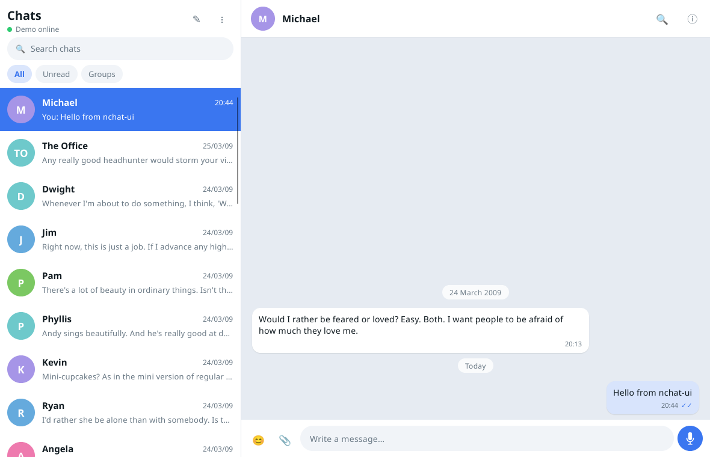
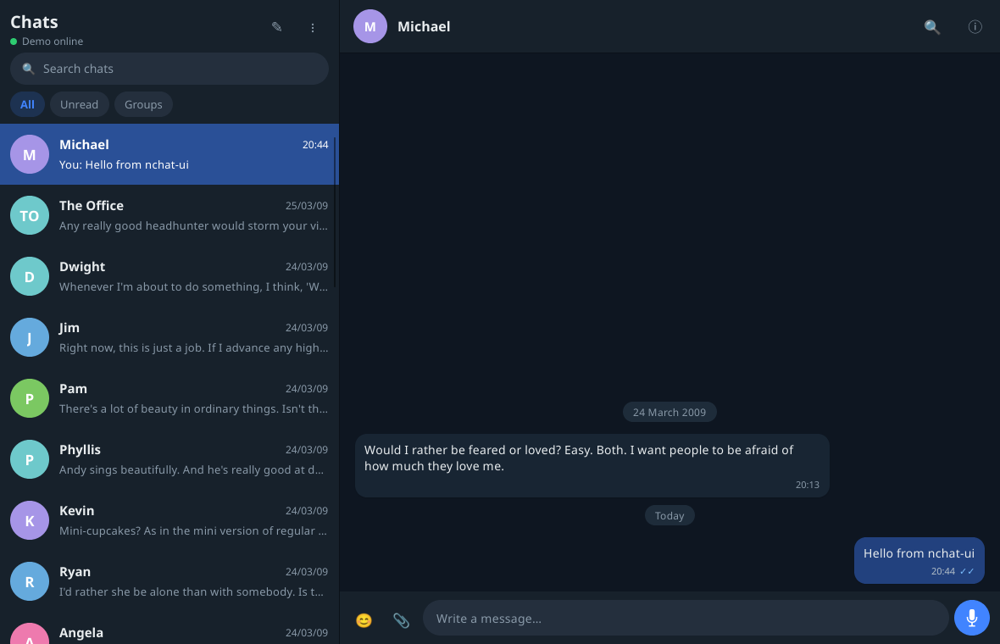

# nchat-ui

A lightweight desktop chat client for **WhatsApp** (and optionally Telegram) with a familiar
chat-list and conversation layout, written in Rust. It uses
[nchat](https://github.com/d99kris/nchat) as its engine, running nchat's own C++ code in
the same process.

> **nchat-ui is an independent project and is not affiliated with nchat or its author.**
> Please report problems with nchat-ui [here](https://github.com/ismaelwarnants/nchat-ui/issues),
> not in the nchat repository.

| Light | Dark |
|---|---|
|  |  |

**Features:** chats and groups, replies, reactions, edits and deletes, photos, stickers,
files, in-app audio playback, voice-note recording (arrives as a real voice note),
drag and drop or paste files, emoji picker, search, channels and status tabs, native
notifications with *Reply* and *Mark as read*, a top-bar icon with background mode and
start at login, light and dark themes with adjustable fonts and colours, and account setup
inside the app (QR code or pairing code).

This project was built using Claude Opus 5.5.

## Install

Download a package for your distribution from the
[latest release](https://github.com/ismaelwarnants/nchat-ui/releases/latest):

| File | For | Install with |
|---|---|---|
| `nchat-ui_<version>-1_amd64.deb` | Debian, Ubuntu, Mint, Pop!_OS | `sudo apt install ./nchat-ui_*.deb` |
| `nchat-ui-<version>-1.x86_64.rpm` | Fedora, openSUSE, RHEL | `sudo dnf install ./nchat-ui-*.rpm` |
| `nchat-ui-<version>-1-x86_64.pkg.tar.zst` | Arch, Manjaro, EndeavourOS | `sudo pacman -U nchat-ui-*.pkg.tar.zst` |
| `nchat-ui-<version>-x86_64.AppImage` | any distribution | `chmod +x nchat-ui-*.AppImage` and run it |
| `nchat-ui-<version>-linux-x86_64.tar.gz` | any distribution, no root | unpack, then run `./install.sh` |

`SHA256SUMS` lists the checksums (`sha256sum -c SHA256SUMS`). The packages are built on
Ubuntu 24.04 and need glibc 2.39 or newer (Ubuntu 24.04+, Debian 13+, Fedora 40+,
current Arch). x86_64 only for now.

Then start **nchat-ui** from your app menu, choose WhatsApp, and scan the QR code with your
phone (*Settings → Linked devices → Link a device*), or tick *"Use phone number + code"*
to get a pairing code instead.

**Release packages support WhatsApp only.** See [Telegram](#telegram) to add it.

## Telegram

Telegram requires every app to identify itself with an API key. nchat ships its own key,
but asks forks that distribute binaries not to use it (it would get rate-limited or
banned), so the release packages leave Telegram out. To use Telegram, build nchat-ui
yourself with your own key:

1. Log in at [my.telegram.org](https://my.telegram.org), open **API development tools**
   and create an application (any title and short name; platform *Desktop*). Note the
   **api_id** (a number) and **api_hash**.
2. Install the build dependencies (see [Quick start](#quick-start), including `gperf`).
3. Build with the key:
   ```bash
   git clone --recurse-submodules https://github.com/ismaelwarnants/nchat-ui.git
   cd nchat-ui
   NCHAT_UI_TG_APIID=12345678 NCHAT_UI_TG_APIHASH=0123456789abcdef0123456789abcdef \
     cargo build --release
   scripts/install.sh
   ```
   Or make installable packages with Telegram included:
   ```bash
   NCHAT_UI_TG_APIID=12345678 NCHAT_UI_TG_APIHASH=0123456789abcdef0123456789abcdef \
     scripts/package.sh
   ```
4. Start nchat-ui and add a Telegram account with the **＋** button next to *Chats*.

Keep your api_hash private: don't commit it or publish builds made with it unless you
mean to share that key. The key is only read at build time. Setting `TG_APIID` and
`TG_APIHASH` in the environment when starting nchat-ui overrides it.

For a build only you use, you can also leave the key out: nchat's built-in key is then
used, just like terminal nchat. Don't give such builds to others.

---

The rest of this document covers building from source and how nchat-ui works inside.

> Built against nchat `master` @ `25a9bd3` (2026-11-22), included as a git submodule.
> nchat's source isn't edited in the repository: two small patches in `patches/nchat/`
> (WhatsApp media re-download and voice notes) are applied at build time.

## Quick start

### 1. Dependencies (Ubuntu/Debian)

```bash
sudo apt install build-essential cmake ninja-build gperf help2man libreadline-dev libssl-dev \
  libncurses-dev zlib1g-dev libsqlite3-dev libmagic-dev golang-1.26-go \
  libfontconfig-dev libxkbcommon-dev libwayland-dev
```

Plus Rust ≥ 1.95 (via [rustup](https://rustup.rs); `rustup update stable`). Go doesn't need
to be on your `PATH`: the build finds `/usr/lib/go-1.NN/bin` automatically.

### 2. Build

```bash
git clone --recurse-submodules https://github.com/ismaelwarnants/nchat-ui.git
cd nchat-ui
cargo build --release
```

Result: **`target/release/nchat-ui`, one ~80 MB file** with nchat, WhatsApp (Go/whatsmeow),
Telegram (tdlib, when `gperf` is installed) and the UI linked in. It only needs the usual desktop system libraries
(OpenSSL, fontconfig, zlib, libmagic). Copy it anywhere.

The first build compiles tdlib and whatsmeow and takes 20–40 min; later builds are
incremental. Build switches (env vars): `NCHAT_UI_WHATSAPP=0|1`, `NCHAT_UI_TELEGRAM=0|1`,
`NCHAT_UI_SIGNAL=0|1` (default auto/auto/off), `NCHAT_UI_JOBS=N`, and `NCHAT_UI_SHARED=1` for
the old layout (binary + `target/lib/*.so` + stock `target/bin/nchat`).

### 3. Install and run

```bash
scripts/install.sh        # copies the binary to ~/.local/bin + adds an app-menu entry
```

Then start **nchat-ui** from your app menu. No terminal needed:

- **First start** shows a welcome screen: pick **WhatsApp** or **Telegram**, enter your
  phone number, and scan the QR code shown in the window with your phone (WhatsApp: *Linked
  devices → Link a device*; Telegram: *Settings → Devices → Link Desktop Device*). Tick
  *"Use phone number + code instead of a QR code"* to get a pairing/login code instead.
  Telegram's login code and 2FA password prompts appear as fields too.
- **More accounts:** the **＋** button next to *Chats*.
- Already use terminal nchat? nchat-ui opens your existing `~/.config/nchat` accounts and
  history directly. Close terminal nchat first (one process per config dir).

**Background mode** (Settings → App → *Keep running in the background*): closing the window
keeps nchat-ui connected, so you keep receiving messages and notifications. An icon in the
top bar (GNOME needs the AppIndicator extension, which Ubuntu enables by default; KDE has
it built in) reopens the window, shows unread chats, and has *Mark all as read*, *Start
when I log in* and *Quit*. Starting nchat-ui again while it runs just brings its window
up. *Start when I log in* adds `~/.config/autostart/nchat-ui.desktop`, which starts it
hidden (`nchat-ui --background`).

`nchat-ui --help` lists options (e.g. `-d <dir>` for a separate config dir).

### Installers

```bash
scripts/package.sh            # all formats into dist/; or e.g. scripts/package.sh deb rpm
```

| File | For | Install with |
|---|---|---|
| `nchat-ui_<ver>-1_amd64.deb` | Debian, Ubuntu, Mint, Pop!_OS | `sudo apt install ./nchat-ui_*.deb` |
| `nchat-ui-<ver>-1.x86_64.rpm` | Fedora, openSUSE, RHEL | `sudo dnf install ./nchat-ui-*.rpm` |
| `nchat-ui-<ver>-1-x86_64.pkg.tar.zst` | Arch, Manjaro, EndeavourOS | `sudo pacman -U nchat-ui-*.pkg.tar.zst` |
| `nchat-ui-<ver>-x86_64.AppImage` | any distro | `chmod +x` and run (the script downloads the official AppImage runtime once) |
| `nchat-ui-<ver>-linux-x86_64.tar.gz` | any distro, no root | unpack, run `./install.sh` |

Packages are WhatsApp-only unless `NCHAT_UI_TG_APIID` and `NCHAT_UI_TG_APIHASH` are set
(see [Telegram](#telegram)); they build in `target/pkg` so your own build isn't touched.
Plus `SHA256SUMS`. Packages contain the binary, desktop entry, icons (16–512 px + SVG),
AppStream metadata, a man page and the licence notices. The version comes from
`Cargo.toml`. The binary uses the build machine's glibc: packages built on Ubuntu 24.04
need glibc ≥ 2.39 (Ubuntu 24.04+, Debian 13+, Fedora 40+, current Arch).

**Licence when distributing:** with WhatsApp support compiled in, the binary is a
combined work under the GPL-3.0 (whatsmeow links libsignal). If you give these
packages to others, they're entitled to the complete source, including nchat-ui's code
and `patches/nchat/`.

### 4. Test without real accounts

```bash
scripts/smoke-test.sh     # empty config -> wizard -> Demo account -> chat; screenshots in target/smoke/
```

Runs headless (no display needed), so it also works in CI.

### 5. Updating nchat

```bash
scripts/update-nchat.sh   # pulls upstream master, checks the Ui contract, rebuilds, smoke-tests
```

### How the in-app setup works (without changing nchat)

nchat's account setup is interactive terminal code (`main.cpp -s` plus each backend's
`SetupProfile`). nchat-ui runs that code unchanged and acts as its terminal:

- At startup, stdin/stdout of the process are pointed at a **pseudo-terminal**. A real tty
  matters: Telegram's 2FA prompt uses `tcgetattr`, which fails on a plain pipe.
  The window reads nchat's output from the other end (`src/term.rs`).
- `src/setup.rs` interprets the output: it answers the *"Select protocol"* and *"Select
  method"* menus itself, shows other prompts (*"Phone number"*, *"Login code"*,
  *"Authentication password"*, …) as a form field, and writes the answer back. Validation
  and error messages are nchat's own.
- nchat shows QR codes by running `xdg-open <qr.png>`. nchat-ui puts a 3-line `xdg-open`
  stand-in first on `PATH` (for its own process only) that reports the image path back over
  the pty, and the window shows the QR (refreshed as WhatsApp rotates it).
- nchat only supports one setup/run per process and locks its config dir, so "add account"
  and "cancel" restart the app in place (`exec`, after releasing nchat's locks).
- The same mechanism covers re-authentication: if a session expires and nchat asks for a
  QR scan or code at login, the wizard pops up.

---

## 1. What nchat looks like inside

nchat is cleanly split into three layers:

```
┌──────────────────────────────────────────────────────────────┐
│ src/main.cpp     arg parsing, profile loading, dlopen, login │
├──────────────────────────────────────────────────────────────┤
│ src/ui*.cpp      ncurses terminal UI  (class Ui)             │  ← the only part we replace
├──────────────────────────────────────────────────────────────┤
│ lib/common/src/protocol.h   abstract Protocol interface +    │
│                             RequestMessage / ServiceMessage  │
│ lib/ncutil       MessageCache (SQLite), config, logging, …   │
│ lib/wmchat  (WhatsApp, Go/whatsmeow)   → libwmchat.so        │
│ lib/tgchat  (Telegram, tdlib)          → libtgchat.so        │
│ lib/sgchat  (Signal)                   → libsgchat.so        │
│ lib/duchat  (dummy protocol for testing)                     │
└──────────────────────────────────────────────────────────────┘
```

Key facts that make a non-invasive integration possible:

1. **Every backend implements one small interface** (`lib/common/src/protocol.h`):
   `Login()`, `Logout()`, `SendRequest(RequestMessage)`, `SetMessageHandler(cb)`.
   Everything is asynchronous message passing: the UI sends `GetChatsRequest`,
   `GetMessagesRequest`, `SendMessageRequest`, `MarkMessageReadRequest`, … and receives
   `NewChatsNotify`, `NewMessagesNotify`, `ReceiveTypingNotify`, `NewMessageReactionsNotify`, …
2. **The backends own the message cache.** `wmchat.cpp`/`tgchat.cpp` call
   `MessageCache::AddFromServiceMessage` / `FetchMessagesFrom` themselves. The UI never
   touches SQLite; it just asks for messages and gets them back (from cache or network).
3. **`main.cpp` only depends on a `Ui` class with 7 methods:**
   `Init()`, `Cleanup()`, `Run()`, `AddProtocol()`, `GetProtocols()`,
   `MessageHandler(ServiceMessage)`, `static RunKeyDump()`.
4. **nchat already uses this seam itself.** The `devnchat` CMake target (Debug builds) compiles
   the *unmodified* `src/main.cpp` together with an alternative `dev/ui.cpp`: a tiny
   line-based REPL UI. We follow the same pattern.

## 2. Options considered

| Approach | Touch nchat? | Robust to updates? | Verdict |
|---|---|---|---|
| Scrape the ncurses TUI (pty / tmux) | No | Very fragile: any layout change breaks it | ✗ |
| Read nchat's SQLite DB directly | No | Read-only, can't send; schema changes (already at v9+) | ✗ |
| Fork nchat and add a GUI | Yes | Constant merge conflicts | ✗ |
| Talk to whatsmeow / tdlib directly | n/a | Re-implements what nchat already solves | ✗ |
| Swap the `Ui` class, separate GUI process over a socket | No | Good | Works, but adds a protocol layer and a second process |
| **Swap the `Ui` class, Rust GUI in the same process via FFI** | **No** | **Depends only on `protocol.h` + 7-method `Ui` shape** | **✓ chosen** |

## 3. Architecture: one process, Rust on top, nchat's C++ underneath

```
┌───────────────────────────── nchat-ui (one executable) ─────────────────────────────┐
│                                                                                     │
│  Rust                                                                               │
│  ┌──────────────────────────────┐        ┌────────────────────────────────────────┐ │
│  │ GUI (Slint), main thread     │◀──────▶│ core: app state (chats, messages, …)   │ │
│  │ chat list, bubbles, composer │        │ Rust wrapper API over the FFI           │ │
│  └──────────────────────────────┘        └───────────▲──────────────┬─────────────┘ │
│                                         events (channel)│              │ direct calls  │
│  ─ ─ ─ ─ ─ ─ ─ ─ ─ ─ ─ ─ ─ ─ ─ ─ ─ ─ ─ ─ ─ ─ ─ ─ ─ ─ ─ ┼ ─ cxx FFI ─ ─┼ ─ ─ ─ ─ ─ ─ ─ │
│  C++                                                    │              ▼               │
│  ┌──────────────────────────────────────────────────────┴───────────────────────────┐ │
│  │ shim/ui.cpp: our `Ui` class   MessageHandler() → Rust callback                  │ │
│  │                               send_*() from Rust → protocol->SendRequest(...)    │ │
│  ├──────────────────────────────────────────────────────────────────────────────────┤ │
│  │ nchat/src/main.cpp (upstream, unmodified, compiled with -Dmain=nchat_main)       │ │
│  │ libncutil · libwmchat.so · libtgchat.so · libsgchat.so (upstream builds)          │ │
│  └──────────────────────────────────────────────────────────────────────────────────┘ │
└─────────────────────────────────────────────────────────────────────────────────────┘
```

No socket, no JSON, no second process. The Rust app makes the **same native calls** the
ncurses TUI makes (`protocol->SendRequest(...)`) and receives the **same callbacks**
(`Ui::MessageHandler(ServiceMessage)`), just across a thin FFI boundary.

### 3.1 The C++ shim (`shim/`): the only C++ we write

Three small pieces:

**a) Our `Ui` class (`shim/ui.cpp`)**, which replaces nchat's ncurses UI and is called by
upstream `main.cpp` exactly like the TUI:

| Step (driven by upstream `main.cpp`) | nchat TUI (`src/ui.cpp`, `src/uimodel.cpp`) | our `Ui` (`shim/ui.cpp`) |
|---|---|---|
| 1. Load profiles from `~/.config/nchat/profiles`, `dlopen` the backends, `protocol->LoadProfile()` | (not involved) | (not involved) |
| 2. `ui->AddProtocol(protocol)` for each account | stores it in its map | stores it in its map |
| 3. `ui->Init()` | sets up ncurses | tells Rust "core ready" + the list of accounts |
| 4. Login thread: `protocol->SetMessageHandler(&Ui::MessageHandler)`, `protocol->Login()` | (not involved) | (not involved) |
| 5. `ui->Run()` (blocks until quit) | ncurses key loop | waits until Rust asks to quit or a SIGTERM arrives (`AppUtil::GetTerminateSignal()`) |
| 6. Backend event → `Ui::MessageHandler(ServiceMessage)` | `UiModel::MessageHandler` redraws | converts to a cxx shared struct and calls the Rust callback |
| 7. On `ConnectNotify`, if the backend lacks `FeatureAutoGetChatsOnLogin`: send `GetChatsRequest` + `GetContactsRequest` | `uimodel.cpp:1627` | same logic, ported |
| 8. User action → `protocol->SendRequest(request)` | `uimodel.cpp:3995` | `send_message()`, `get_messages()`, … called from Rust build the same request objects |
| 9. `Run()` returns → `main.cpp` calls `Logout()`, `CloseProfile()`, cleans up | (not involved) | (not involved) |

**b) Running upstream `main.cpp` as a library function.** `main.cpp` is compiled unmodified
with `-Dmain=nchat_main`, so it becomes `int nchat_main(int, char**)`. Rust calls it on a
dedicated "nchat-core" thread with arguments such as `["nchat-ui", "-d", confdir]`. All
startup logic (dir version check, locks, profile loading, dlopen, login, logout, cleanup)
stays upstream's. If `nchat_main` returns (config dir locked, no accounts, SIGTERM, …), Rust
gets the return code: the window closes, or shows how to add an account.

One subtlety: CMake compiles a *byte-identical copy* of `main.cpp` from the build directory.
C++ resolves `#include "ui.h"` in the including file's own folder first, so compiling it in
place would silently pick up nchat's terminal `ui.h` instead of ours. (nchat's own `devnchat`
target has exactly that problem.)

**c) The FFI surface (`src/ffi.rs` + `shim/bridge.cpp`)**, using the [`cxx`](https://cxx.rs)
crate for type-safe Rust ↔ C++ calls (no hand-written `extern "C"`, no manual memory management).
Abridged:

```rust
#[cxx::bridge(namespace = "nchatui")]
pub mod ffi {
    // Plain-data mirrors of protocol.h structs (filled in by bridge.cpp)
    pub struct Chat    { id: String, is_unread: bool, is_muted: bool, is_pinned: bool, last_message_time: i64, … }
    pub struct Message { id: String, sender_id: String, text: String, quoted_id: String, file_path: String,
                         file_status: i32, time_sent: i64, is_outgoing: bool, is_read: bool, reactions: Vec<Reaction>, … }
    pub enum EventKind { Ready, Connect, Contacts, Chats, Messages, SendResult, MessageStatus, Typing,
                         UserStatus, MessageFile, MessageReactions, …, Other }
    pub struct Event   { kind: EventKind, profile_id: String, chat_id: String, chats: Vec<Chat>, messages: Vec<Message>, … }

    extern "Rust" {
        fn on_event(ev: Event);                       // called from nchat's threads
    }

    unsafe extern "C++" {
        include!("nchat-ui/shim/bridge.h");
        fn run_core(args: Vec<String>) -> i32;        // wraps upstream main()
        fn request_quit();
        fn get_messages(profile: &str, chat: &str, from_msg_id: &str, limit: i32);
        fn send_message(profile: &str, chat: &str, text: &str, quoted_id: &str, quoted_text: &str,
                        quoted_sender: &str, file_path: &str);
        fn mark_read(profile: &str, chat: &str, sender_id: &str, msg_id: &str);
        fn send_reaction(…); fn download_file(…); fn edit_message(…); fn delete_message(…); …
    }
}
```

All knowledge of `protocol.h` lives in **one file, `shim/bridge.cpp`** (struct conversion +
request building). When nchat adds a field or message type, that is the file to touch.

### 3.2 Threads

| Thread | Owner | Does |
|---|---|---|
| main | Rust / Slint | GUI event loop (GUI toolkits require the main thread) |
| nchat-core | Rust spawns, runs `nchat_main()` | upstream startup, then blocks in our `Ui::Run()` |
| nchat login + backend threads (Go runtime, tdlib) | nchat | call `Ui::MessageHandler` → `on_event()` |

`on_event()` never touches the GUI directly: it pushes the event onto a channel, and the GUI
thread applies it to the app state (`slint::invoke_from_event_loop`). Calls from Rust into C++
(`send_message`, …) are thread-safe because `Protocol::SendRequest` is designed to be called
from the UI thread while the backends run on their own threads (the TUI does this).

### 3.3 The GUI toolkit

**Recommended: [Slint](https://slint.dev) (Rust API).** Native rendering (no webview, no
Chromium), very small memory and binary footprint, declarative `.slint` markup that makes a
WhatsApp/Telegram-style layout easy, virtualized `ListView` for long chats, light/dark theming.

Alternatives, all workable with the same `core` + FFI underneath:
- [iced](https://iced.rs): pure Rust, Elm-style, also light.
- [egui](https://github.com/emilk/egui): lightest to build, but looks more like a tool than a chat app.
- Tauri: Rust backend + HTML/CSS front-end. Easiest to make pretty, but brings back a webview
  (more RAM) and a JS layer.

**Risk to check first (spike in M0):** color emoji and complex text rendering in the chosen
toolkit. Chats are full of emoji, so this decides the toolkit before we build screens.

UI scope for v1:
- Left pane: chat list with avatar initials, last message preview, time, unread badge,
  pinned/muted icons, search; account switcher if multiple profiles.
- Right pane: message bubbles (in/out), date separators, replies/quotes, reactions,
  read ticks, typing indicator, image thumbnails (from downloaded files), emoji picker,
  attach file, drag & drop.
- Light/dark themes following the system, keyboard shortcuts.
- Desktop notifications for new messages in unmuted chats (`notify-rust`).

## 4. Repository layout and build

```
nchat-ui/
├── nchat/                  # git submodule → github.com/d99kris/nchat (never edited)
├── shim/
│   ├── CMakeLists.txt      # builds upstream nchat + libnchatcore (upstream main.cpp + our Ui)
│   ├── ui.h / ui.cpp       # our Ui class (same shape as nchat/src/ui.h)
│   ├── core.h              # tiny C++ API around it (run main, hooks, get protocol)
│   └── bridge.h / .cpp     # protocol.h <-> cxx structs, request builders
├── src/
│   ├── main.rs             # CLI, spawns the nchat-core thread, starts Slint
│   ├── ffi.rs              # #[cxx::bridge] definitions
│   ├── core.rs             # app state, event handling, models for the UI, restarts
│   ├── term.rs             # pseudo-terminal acting as nchat's stdin/stdout + xdg-open stand-in
│   ├── setup.rs            # account wizard: interprets nchat's setup prompts / QR codes
│   └── headless.rs         # off-screen renderer for scripted tests (NCHAT_UI_SCRIPT)
├── ui/                     # app.slint (chat UI), setup.slint (wizard), theme.slint
├── scripts/                # smoke-test, check-ui-contract, update-nchat, install
├── build.rs                # runs CMake (cmake crate) + cxx-build + slint-build
└── Cargo.toml
```

**`shim/CMakeLists.txt`** does `add_subdirectory(../nchat)` to reuse nchat's own build (ncutil,
protocol libraries, generated headers, Go/whatsmeow handling, feature flags) and adds one static
library, mirroring the existing `devnchat` target:

```cmake
configure_file(${NCHAT_DIR}/src/main.cpp ${UPSTREAM_MAIN} COPYONLY)   # see 3.1 b
add_library(nchatcore STATIC ${UPSTREAM_MAIN} ${NCHAT_DIR}/src/theme.cpp ui.cpp)
set_source_files_properties(${UPSTREAM_MAIN} PROPERTIES COMPILE_DEFINITIONS "main=nchat_main")
target_include_directories(nchatcore PRIVATE ${CMAKE_CURRENT_SOURCE_DIR}  # our ui.h first
  ${NCHAT_DIR}/lib/common/src ${NCHAT_DIR}/lib/ncutil/src ${NCHAT_DIR}/src …)
target_link_libraries(nchatcore PUBLIC ncutil)
add_dependencies(nchatcore nchat duchat tgchat wmchat)  # backends are dlopen()ed, not linked
# + the same HAS_* definitions the upstream nchat executable gets
```

**`build.rs`** runs that CMake project via the `cmake` crate (auto-detecting Go and gperf),
compiles `bridge.cpp` with `cxx-build` and the `.slint` files, then links.

**One binary.** By default nchat is configured with its own `HAS_SHARED_LIBS=OFF` (the mode
nchat uses for static/OpenBSD builds): backends, tdlib and the Go runtime become static
archives and nchat's `main.cpp` creates protocols directly instead of `dlopen`ing them. CMake
knows the full, correctly ordered list of archives and system libraries, so the shim builds a
tiny *link probe* executable and `build.rs` copies that link line from `build.ninja` into
rustc's link arguments. With `NCHAT_UI_SHARED=1` you get the previous layout instead
(`target/lib/*.so`, `dlopen`ed from `<exe dir>/../lib`).

> Note: `devnchat` upstream doesn't list `src/theme.cpp` and compiles `main.cpp` against the
> wrong `ui.h` (see 3.1 b). Worth reporting upstream as a small fix.

## 5. Things to handle in a shared process

- **Signals.** `main.cpp` installs nchat's handlers (crash logging on SIGSEGV/SIGABRT; SIGTERM/SIGHUP
  set a flag that our `Ui::Run()` polls via `AppUtil::GetTerminateSignal()` to start a clean
  shutdown). They behave as in the TUI. The Go runtime in `libwmchat.so` installs its own as it
  does in nchat today. Rust installs none by default, so no conflict.
- **Crashes.** One process means a crash in a backend (Go/tdlib) also closes the window, which is
  the same as the TUI today. A panic in Rust code must never unwind into C++: every
  `extern "Rust"` callback is wrapped in `catch_unwind`.
- **Shutdown order.** Window close → `request_quit()` → our `Ui::Run()` returns → upstream
  `main.cpp` logs out and cleans up → `nchat_main` returns → the Rust process exits. A timeout
  (like nchat's own 5-second watchdog) prevents a hung logout from freezing the window.
- **stdout.** `main.cpp` prints a few messages with `std::cout` (e.g. "Failed to load …").
  Harmless in a GUI; we also show the return code and point to `log.txt` on failure.

## 6. Accounts, login and data

- **Only nchat's code reads the config folder's contents.** It's opened by upstream `main.cpp`
  and the protocol libraries, the same way as in terminal `nchat`. nchat-ui itself only lists
  the names under `profiles/` (to decide whether to show the welcome wizard) and, when you
  cancel a setup halfway, deletes the profile folder that setup had just created. Otherwise
  the only files the window opens are downloaded media, at paths the backend reports.
- **The lock is held by nchat-ui, the way terminal nchat holds it.** nchat-ui simply *is* nchat
  with a different UI. The rule is the same as today: one nchat process per config folder at a
  time, so close terminal `nchat` while the window is running.
- **Login / adding accounts** happens in the window (see *How the in-app setup works* above),
  driving nchat's own setup code. The result is the same profile terminal nchat creates.
- Settings nchat already exposes (`downloads_dir`, `attachment_open_command`, …) keep working
  because they are read by ncutil, not by the ncurses UI.

## 7. Staying compatible with nchat updates

What we depend on, ranked by how often it changes upstream:

| Dependency | Change rate (since 2025-01) | Impact |
|---|---|---|
| Protocol backends (wmchat/tgchat/sgchat) | High | **None**: we just rebuild them |
| `src/main.cpp` | ~27 commits | Low: compiled as-is; only a change to the 7 `Ui` methods matters |
| `lib/common/src/protocol.h` | ~20 commits | Medium: new fields/notify types → update `shim/bridge.cpp` |
| `src/ui*.cpp` (ncurses UI) | High | **None**: we don't use it |

Safeguards:

1. **Pin nchat as a submodule.** Updating is: bump, `cargo build`, run tests.
   One deliberate exception to "never modify nchat": `patches/nchat/*.patch` (currently
   only media retry) are applied to the checkout by `build.rs`. The build detects an
   already-applied patch, re-applies it after an update, and **stops with an error** if
   it no longer applies, so a conflicting upstream change can't slip through silently.
   `scripts/update-nchat.sh` takes the patches off before switching versions. The
   patches are written to be proposed upstream; once nchat includes the fix, delete the
   patch file.
2. **The compiler checks the contract.** If upstream changes a `protocol.h` struct or a `Ui`
   method we use, `bridge.cpp`/`ui.cpp` fail to compile, so we never ship a silent mismatch. A
   small test also diffs `nchat/src/ui.h`'s public methods against ours, to catch *added* ones.
3. **Unknown messages never crash.** `bridge.cpp` forwards unknown `ServiceMessage` types as
   `EventKind::Other`, so a new notify type is ignored (visible with `NCHAT_UI_DEBUG=1`), not a crash.
4. **End-to-end test with nchat's dummy protocol (`scripts/smoke-test.sh`).** Sets up a Dummy
   account through upstream's setup code, opens chats, sends a message, renders screenshots
   headlessly and checks nchat's log for a clean start/shutdown. No real accounts or display needed.
5. **`scripts/check-ui-contract.sh`** diffs `nchat/src/ui.h`'s public methods against ours.
6. **`scripts/update-nchat.sh`** does all of the above in one go when bumping nchat.
7. *(Todo)* Nightly upstream canary in CI: build against nchat `master` and run the tests.

## 8. Feature parity with nchat

Everything nchat's terminal UI can do, and where it lives in nchat-ui. "nchat: no" means
nchat itself doesn't support it, so nchat-ui can't either without changing nchat.

| Feature | nchat | nchat-ui |
|---|---|---|
| Chat list, unread badges, pinned/muted markers, typing indicator | yes | yes |
| Send / reply / edit / delete messages, reactions | yes | yes (right-click a message; *React…* opens the full picker) |
| Send files, download / open / save attachments | yes | yes (📎, click the card, *Save as…*) |
| Auto-download media (`attachment_prefetch`) | yes | yes, configurable (Settings → Download media automatically) |
| Forward message (`forward_msg`) | yes | yes (*Forward…*) |
| Jump to quoted message (`jump_quoted`) | yes | yes (click the quote) |
| Search in chat (`find`, `find_next`) | yes | yes (🔍 in the chat header, ⌃ for older matches) |
| Pin / unpin message, jump to pinned (`jump_pinned`) | yes (where the service supports it) | yes (📌 in the header) |
| Pin / archive / delete chat (`archive_chat`, `delete_chat`) | yes | yes (right-click a chat, or chat info) |
| Start chat with a contact (`select_contact`) | yes | yes (✎ New chat) |
| Group members | yes | yes (chat info) |
| Mark read on view, online/typing status sharing | yes (`ui.conf`) | yes (Settings → Privacy) |
| Desktop notifications | yes (`desktop_notify_*`, runs a command) | native notifications: one per chat, buttons *Reply* (opens the chat) and *Mark as read*; inline reply on macOS. GNOME has no inline-reply support |
| Multi-line messages (`linebreak`) | yes | yes (Shift+Enter, or switch Enter/Ctrl+Enter in settings) |
| Add / remove account (`-s`, `-r`) | yes | yes (⋮ → Add account; Settings → Accounts → Remove) |
| Open links in messages (`open_link`) | yes | yes: links are clickable; right-click → *Copy link*; text is selectable (Ctrl+C) |
| WhatsApp text formatting (*bold*, _italic_, ~strike~, `code`) | shows the raw markers | rendered as formatting |
| Copy message text | yes | yes |
| Mute / unmute a chat | no (only shows mute state from the phone) | shows mute state |
| @mentions picker (`select_mention`) | yes | **not yet** (typing `@Name` sends plain text) |
| Paste image from clipboard | yes | **not yet** (use 📎) |
| Open message in external viewer/editor (`open_msg`, `ext_edit`) | yes (external commands) | not planned: the window is the editor |
| Spell check, auto-compose (AI), call (`spell`, `auto_compose`, `ext_call`) | yes, via user-configured external commands | **not yet** |
| Export chats (`-x`) | yes | CLI only: `nchat-ui -x <dir>` (close the app first) |
| Profile pictures | **no** | no: initials avatars |
| "About"/status text, contact details beyond name + phone | **no** | no |
| Calls, stories/status updates, communities, disappearing-message settings, locked chats, starred messages, chat themes | **no** | no |
| Re-download expired old media (WhatsApp "media retry") | **no** | yes, via the carried nchat patch (phone must be online) |

**Channels and Status:** WhatsApp channels (`…@newsletter`) and Telegram channels get their
own *Channels* tab (kept out of *All*, no notifications, like WhatsApp). WhatsApp status
updates (stories) arrive in nchat's `status@broadcast` chat; the *Status* tab shows one row
per person for the last 24 hours and opens just that person's updates (view-only: sending
there would post a status of your own). Telegram channels are recognised by their posts
being sent by the channel itself, since nchat doesn't expose Telegram's channel flag.

**Voice notes:** with the message box empty, the send button becomes a microphone. The
recording is encoded like WhatsApp's own (Ogg/Opus, mono, 48 kHz) with a duration and
waveform, and nchat (patch `0002-wmchat-voice-notes`) sends it as a real voice note
(`PTT`), not an audio file. On Telegram it currently arrives as an audio file.

**Files:** drag files from a file manager onto a chat, or paste them (Ctrl+V on files
copied in the file manager, or an image/screenshot); a confirmation lists what will be
sent. Dropping files needs the window to run through X11/XWayland (Settings → App →
*Allow dragging files into the window*, on by default), because the UI toolkit's Wayland
support can't receive file drops yet; apps opened from nchat-ui still get Wayland.

UI-only extras: in-app audio player (voice notes: Ogg/Opus, plus MP3, AAC/M4A, Vorbis, FLAC,
WAV; play/pause, seek, 1×/1.5×/2×), *Open with…* (choose any installed app for a file),
WhatsApp-style stickers (WebP, shown without a bubble) and WebP/GIF
images, background mode with tray icon and start at login, single instance, full emoji picker (all Unicode emoji up to 15.1, search, recents),
colour emoji everywhere (keycaps, flags, skin tones), jump-to-bottom button with a
new-message count, history-sync indicator, unread count in the window title, themes (system/light/dark), accent colour, font family and size, compact
list, bubble roundness, chat background and bubble colours, 12/24-hour clock, chat
filters (All / Unread / Groups / Archived), mark all as read, contact/group info panel.
Settings are saved in `~/.config/nchat-ui/settings.conf`; nchat's own config is untouched.

### Media from before you linked WhatsApp (patched)

Attachments that arrive through WhatsApp's one-time **history sync** (everything older
than the moment you linked) only carry a "direct path", and WhatsApp's media servers
answer 404/410 for most of them until the phone re-uploads the file. WhatsApp Web asks
for that automatically ("media retry"); upstream nchat doesn't.

nchat-ui carries two small patches: `0002-wmchat-voice-notes.patch` (send recordings as
voice notes, see above) and, for this, `patches/nchat/0001-wmchat-media-retry.patch`:
on a 404/410, nchat's WhatsApp backend asks your phone to re-upload the file, shows it
as *Downloading…*, and downloads it from the new location when the phone answers. It
also remembers that location for next time. Your **phone must be online**. If it no
longer has the file, or doesn't answer within 60 s, the attachment shows *Download
failed*. Automatic downloads are limited to the 15 newest attachments in view, so
opening a chat never fires dozens of re-upload requests; click older ones to fetch them.

### Platforms

| | Status |
|---|---|
| Linux (X11/Wayland) | supported, tested on Ubuntu 24.04 / GNOME 46 |
| macOS | should work: nchat supports macOS and the app's platform-specific bits (`open`, `/dev/fd`, notifications with inline reply, LaunchAgent for start at login) are handled, but it hasn't been built or tested there yet. No menu-bar icon yet |
| Windows | not possible natively: nchat itself doesn't run on Windows (ncurses, POSIX ptys, `flock`, `dlopen`). Use WSL2 with WSLg |

### Dev switches

`NCHAT_UI_SCRIPT` (scripted headless runs, see `src/main.rs`), `NCHAT_UI_DEBUG=1` (event
trace), `NCHAT_UI_FAKE_SYNC=1` (preview the sync indicator), `NCHAT_UI_EMOJI_VERSION=16.0`
(newer emoji in the picker if your emoji font has them), `SLINT_DEFAULT_FONT` /
`SLINT_FONT_PATH` (override the font chain), `cargo run --release --example emoji_test`
(emoji rendering check).

## 9. Roadmap

| Milestone | Deliverable | Status |
|---|---|---|
| M0–M3 | Core app: chats, messages, media, replies, edits, reactions, notifications | ✅ done |
| M5 | In-app account setup (QR, pairing code, Telegram code/2FA), single self-contained binary | ✅ done |
| M6 | Settings (appearance, privacy, notifications), chat filters, archive/pin/delete chat, pin message, search in chat, forward, new chat, chat/group info, remove account in UI, sync-safe close | ✅ done |
| M7 | Clickable/selectable links + WhatsApp formatting, full emoji picker + colour emoji fix, jump-to-bottom, sync indicator, native notifications with actions | ✅ done |
| M8 | Stickers/WebP, background mode, tray icon, start at login, single instance | ✅ done (Linux; macOS: start at login done, tray to do) |
| M9 | In-app audio player, Open with…, app icon, Linux installers (.deb/.rpm/Arch/tar.gz/AppImage) | ✅ done |
| M10 | Channels + Status tabs, voice-note recording (sent as real voice notes), drag & drop and paste of files with confirmation | ✅ done (v0.2.0) |
| v0.2.1 | Fixes: window froze briefly on new messages / opening a chat (tray update and image decoding moved off the UI thread); short chats sit at the bottom; the view stays at the bottom while images and new messages load | ✅ done |
| v0.2.2 | Fix: uninstalling the user-local install (`scripts/install.sh` or the tarball's `install.sh`) left a stale icon cache, so a later system install showed a generic icon in the dock and app menu | ✅ done |
| M11 | @mentions, animated stickers, video preview, Telegram voice notes, macOS build + menu-bar icon, upstream canary CI | open |
| nchat | Media retry for history-synced WhatsApp media | ✅ carried patch; to propose upstream |
| nchat | History-sync percentage | needs an nchat change (could join the same patch) |
| Upstream | Profile photos / "about" text: needs nchat to expose them (whatsmeow and tdlib both can) | idea: propose to nchat |

## 10. Licensing notes

nchat is MIT. Its protocol libraries pull in third-party code with other licenses: with
WhatsApp built in, nchat itself reports the combined binary as GPL-3.0 (whatsmeow links
libsignal); the Signal backend makes it AGPL-3.0. See `nchat/LICENSE*` and
`nchat/lib/*/THIRD_PARTY_LICENSES`. Slint is available under GPLv3 or a free royalty-free
license for desktop apps. nchat-ui's own code is MIT (`LICENSE`); the release packages, which contain whatsmeow
and libsignal, are distributed as a whole under the GPL-3.0 (`packaging/copyright`), and
this repository is their complete corresponding source. Signal is never built into
release packages.
